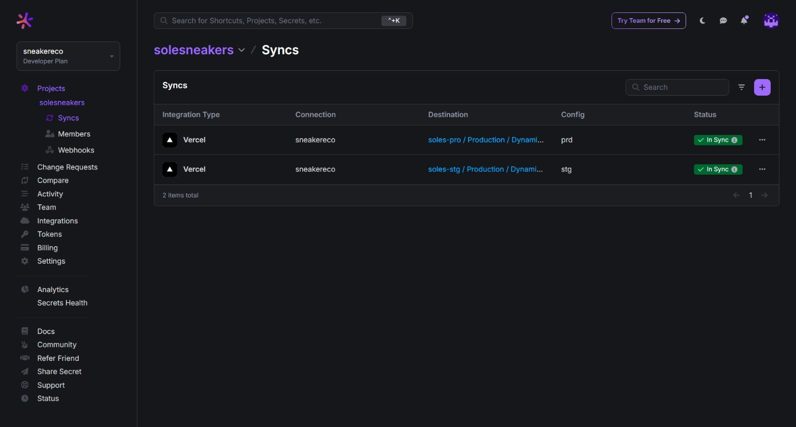
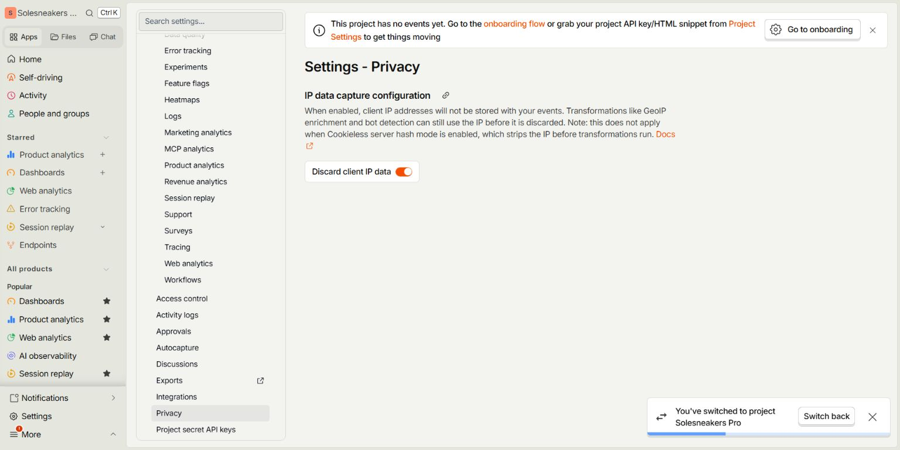

# PostHog setup and launch assessment

The later [local implementation handoff](admin-analytics-local-handoff-2026-11-27.md) records completed code corrections, provisioning and observer tools, independent review and final local qualification. The assessment below records the earlier browser-session state; its code findings are now addressed. Hosted setup and acceptance are still pending.

Verified through the owner's signed-in Chrome session on November 27, 2026. No secret values are recorded here. This records account setup and a bounded read-only code assessment, not completed analytics deployment.

## Fresh launch

No historical events, 24 months of existing data, backfill, or historical-order import are required. Measurement starts at dataset activation. Reports must show the history actually collected and retained; unavailable periods must not become invented zeroes.

The account's existing Pay-as-you-go plan lists two years of future event retention. Authenticated, read-only project retention pages returned `default_retention_months=24`, `plan_retention_months=24` and the explicit current `retention_months=null, retained_from=null` pair for both projects. This is not proof that historic events exist or that retention will remain unlimited. No plan, billing, or retention setting was changed.

## Account configuration completed

| Item                      | Verified result                                                                                                                                                                                                     |
| ------------------------- | ------------------------------------------------------------------------------------------------------------------------------------------------------------------------------------------------------------------- |
| PostHog organization      | Sneakereco, `01a0a1e0-6eef-0000-cf47-29ac7ef133d7`                                                                                                                                                                  |
| Staging project           | Solesneakers Stg, `609594`, US Cloud                                                                                                                                                                                |
| Production project        | Solesneakers Pro, `771344`, US Cloud                                                                                                                                                                                |
| IP discard                | Enabled in both; staging was already enabled, production was updated                                                                                                                                                |
| GeoIP transformation      | Paused in both; production was updated                                                                                                                                                                              |
| Autocapture               | Disabled in both; production was updated; web vitals and dead-click autocapture were also off                                                                                                                       |
| Session replay            | Disabled in both                                                                                                                                                                                                    |
| Runtime query credentials | Existing project secret keys have only `endpoint:read`; Doppler project IDs and capture/query keys match the respective projects                                                                                    |
| Development               | Uses the staging project and query key; its capture flag was saved as false                                                                                                                                         |
| Production identity       | At least 32 bytes, distinct from development; not changed. Staging's existing identity secret is present, with full server-parser verification still pending                                                        |
| Capture                   | Saved as false in `dev`, `stg`, and `prd`; existing public browser bundles still require a new build to change their baked configuration                                                                            |
| Vercel syncs              | `stg` → `soles-stg / Production / Dynamic`, `prd` → `soles-pro / Production / Dynamic`; both show In Sync                                                                                                           |
| Operator configuration    | Created `stg_analytics_operator` and `prd_analytics_operator` branches with owner organization/project IDs                                                                                                          |
| Operator credential       | Created after explicit action-time approval; **Sole Analytics Operator**, `project:read` only, access restricted to Stg and Pro, no automatic expiration; saved and read back successfully in both operator configs |

The two existing Vercel syncs target only the application root configs, not the operator branches. Runtime query credentials were preserved. The operator key is not a provisioning key and cannot create Endpoints or modify source connections.

## Concrete deployment prerequisite

Both PostHog projects currently show the empty warehouse-source and Endpoint onboarding screens. Both hosted Supabase database schema selectors list the standard schemas but omit `analytics_reporting` and `analytics_source`. The feature migrations have not been qualified or installed there by this work. No hosted database, grant, role login, deployment, dataset activation, or capture probe was changed or executed.

The financial feed cannot be wired correctly before its reporting views and restricted readers exist. The 22 saved Endpoint definitions also include a fixed activation instant. Do not invent a launch instant or connect an application owner/service credential merely to complete the UI wizard. Apply the reviewed feature migrations and reader audit first, then provision the exact sources and versioned definitions for the selected launch.

`ANALYTICS_VERIFIED_PAIRING` was deliberately not written: the full source, definition and launch checks have not passed. The owner CLI verifier, configured build, hosted query execution, connector behavior, scheduler and real purchase/refund journey remain unverified.

## Code assessment

This assessment read selected launch/configuration paths. It was not a complete Task 14 or whole-branch review, did not change application code and did not run test suites.

1. **Replace the blanket retention minimum.** `scripts/refresh-admin-analytics.mjs:163` and `supabase/migrations/20261127033000_native_retention_gate.sql:29`, `:48`, `:63` reject native capacity below 24 months. That is a future-capacity rule, not a historical-data rule. The observed account currently satisfies the code through its explicit null pair, so a historical import is unnecessary. For the fresh-launch requirement, accept verified actual retention while preserving metadata validation, attestation expiry, the rolling retention floor, provider `retained_from`, launch/observation boundaries and irreversible-loss handling. Add short-retention fresh-launch and expiry regressions. Existing report coverage already clips to activation; a broad reporting rewrite is unnecessary.
2. **Bind automated journey verification to the actual purchase link.** `EventDelivery/journey-evidence.ts:83` independently matches browser session events and fixture order/refund facts. Require the exact active session/order purchase link with valid consent, and cover mismatched, missing and revoked links. Until corrected, independently verify that link during hosted acceptance.
3. **Address the launch inventory boundary.** `20261125180100_admin_analytics_source_hooks.sql:265` uses transaction-start time for deferred inventory publication. Correct and review its timestamp policy with a two-connection regression, or quiesce inventory writers and drain prelaunch transactions before activation. This is already an explicit activation mitigation.
4. **Wire actual scheduled execution.** The repository provides observer CLIs and instructions, not a deployed protected scheduler. Schedule and monitor the native observer and bounded warehouse drain with the shared query budget and isolated operator config. No archival pipeline is needed to launch with fresh native events.

## Remaining sequence

Use the [current staging handoff](admin-analytics.md#prepare-the-source-definitions-and-launch) for local preview, initial v1 provisioning and the protected observer workflow. The workflow and provisioner have no effect on the recorded hosted state before the owner's explicit setup and opt-ins.

1. Complete the small code corrections and the outstanding full Task 14/whole-branch reviews.
2. Deploy ordered feature migrations through the established staging workflow; audit the restricted reader before enabling its login.
3. Configure the finance and purchase-link warehouse views with exact aliases, composite keys, update cursor and revocation tombstones. Verify actual connector behavior.
4. Select the activation instant, generate the manifest and provision its 22 version-pinned Endpoints. Configure the protected scheduler and prime a real nonvisitor opening marker from the isolated operator process while deployed capture remains off.
5. Perform one-time activation/current-stock baseline, establish actual observations, then build/deploy matched public and private configuration. Run real staging consent, purchase, completed refund, session/order link, report/CSV and freshness checks.
6. Use the separate production release/tag gate after staging acceptance.

No PR, push, shared-branch merge, production release or application deployment occurred during this setup session.
