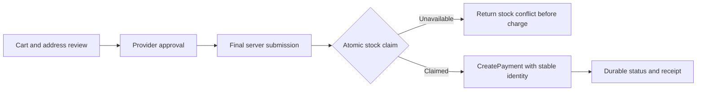

# Checkout final payment implementation

The approved stock policy is implemented on `codex/checkout-final-payment`, based on `eb8d90b671b83f3be1fca402a64e5c2004523d10`. This branch has not been deployed. The [incident audit](checkout-guest-afterpay-investigation-2026-11-27.md), [provider research](inventory-payment-finalization-research-2026-11-27.md), and [design](../superpowers/specs/2026-11-27-checkout-final-payment-design.md) explain the evidence and business rule.

## Resulting flow

Address and total review creates no order, credential, or stock reservation. Square SDK approval also claims no stock. With a usable source, one final server request verifies the original browser verdict, signed owner and one-time guest challenge, recalculates the exact approved checkout, atomically claims all units, issues a fresh payment permit, and dispatches payment. A competing claim loses before the backend charge. `/prepare` resumes existing orders; stale tabs cannot start new holds through that compatibility endpoint.

The existing guarded expiry remains a crash fallback after the buyer approves payment. Unknown or dispatched payments retain their financial recovery protections; elapsed time alone cannot release them. An order can still hold stock if the server fails between claim and dispatch, until the existing worker safely closes it.

## Checkout repairs

- Accepted suggested addresses keep their own exact quote through same-owner session verification.
- Short payment permits are issued after SDK approval, avoiding the old two-minute permit expiring while Afterpay is open.
- Provider approval and owner waits are bounded. Cash App cancellation and expiry retire old listeners, reset pending state, and permit the same method to retry. Late callbacks cannot submit.
- Both new submission and original-order retries persist and verify recovery state before sending payment. A reload or lost response checks the original key, owner, and device.
- Financial lookup is bounded and can refresh a guest token that browser storage could not retain. Optional Cart association finds only an existing owned capture, never creates a replacement, and cannot indefinitely block order status. Verified receipts consume the original unit lineage and preserve items added later.
- Immediate decline retries await the latest scoped availability check; a superseded check cannot strand them until reload.
- A canceled order with correlated ledger evidence of zero capture and zero refund retires the original browser attempt without consuming Cart units. Legacy, refunded, and uncertain cancellations remain protected. A buyer can then start a fresh checkout safely.
- Changed review quotes refresh the visible total. Proven stock conflicts refresh availability and offer cart recovery.
- A permit outage on a reused order leads to observation of the original payment, rather than claiming that the order has never submitted a payment.
- Admin pending, overdue and closed-expired labels remain distinct. Overdue pending orders say their payment window expired and are awaiting verification; only canceled orders with `checkout_expired` show closed checkout expiration.
- BotID deep analysis, proxy admission and sanitized request metrics include both new routes. Sources and permits remain ephemeral and are not included in submission responses or diagnostics.

## Production recovery verification

Production independently advanced to `dpl_J8QGFsP7iuELSsUP5YUQtAckqHkA`, source `eb8d90b671b83f3be1fca402a64e5c2004523d10`, created November 27 at 8:43:47 p.m. ET. Read-only checks confirmed the newer recovery migrations are applied. Orders `63a724fc-71c0-4c37-91c4-750f0f41d3c4`, `167d23ae-5d41-4f84-8118-3d05e5770fd8`, and `5af05832-c708-4d34-b8b1-eae47bb8e605` are now canceled with reason `checkout_expired`, with no recorded payment transaction. All five reservation units are released. A later one-hour checkout-error log query had no matching groups.

Those deployed changes include terminal-negative evidence reconciliation, safe closure after verified failed tenders, bounded worker concurrency and sanitized dependency diagnostics. They are part of this branch's base. The new later-claim flow and client repairs remain undeployed.

A final read-only refresh at approximately 10:35 p.m. ET found production on `dpl_5LGpgyJaAdqNXu9xryuajijCLxHj`, source `6d39b15b19ba56d76941e23aee674d8740b5f7ef` (analytics reporting PR #67), created at 9:39:40 p.m. ET. The latest-hour error/fatal grouping showed no checkout paths. Sampled errors showed storefront product-cache revalidation failing with `TypeError: fetch failed`, including requests to store and policy pages. These are unresolved dependency signals; the logs do not establish a connection to payment dispatch. The production checkout changes on this feature branch are still absent from that deployment.

## Verification and review

Verification on the implementation tree:

| Check                                             | Result                                                            |
| ------------------------------------------------- | ----------------------------------------------------------------- |
| Full Jest unit suite                              | 240 suites, 1,880 tests passed                                    |
| Jest integration suite                            | 4 suites, 38 tests passed                                         |
| Isolated SQL concurrency and reservation suite    | 17 tests passed                                                   |
| Final-payment and order-outcome browser suites    | 84 tests passed (18 new-flow cases and 66 existing outcome cases) |
| Cart state and original-unit browser suites       | 149 tests passed                                                  |
| Full checkout UX sweep                            | 50 cases passed                                                   |
| Payment methods, checkout UI, shipping validation | Passed                                                            |
| Receipt and processing wrapper suites             | 12 and 36 cases passed                                            |
| Admin transaction browser checks                  | Passed                                                            |
| Checkout browser runner tests                     | 14 tests passed                                                   |
| Next.js production build                          | Passed with normal tracked configuration and dummy CI credentials |
| ESLint on changed code                            | 44 files, zero errors or warnings                                 |

Controlled browser tests exercise the real session, Cart, checkout and outcome components; API and Square SDK boundaries are mocked. SQL tests use an isolated local Docker project. These checks do not prove real provider or physical-device behavior. The final build used a fresh generated cache after Turbopack cached a local worker-launch error; no application configuration change was needed.

A fresh reviewer identified two critical and four important issues. The implementation addresses browser BotID registration, uncertainty persisted before dispatch, Cash App retirement and deadlines, stale review state, reused-order permit ambiguity, and neutral pending-order labels. Targeted regressions were observed failing before the corresponding repairs. Further regression work covers original retry submission, recovered unit lineage, unstored guest access, bounded lookup, and safe retirement of verified unpaid cancellations. The new final-payment browser suite is included in the checkout CI gate. Earlier Cart checkout fixtures assumed reservations and permits before SDK approval; those cases now assert the approved final-claim boundary, including competing stock, changed prices/totals, replacement quantities, owner changes, and retired callbacks.

## Decisions and release gates

The post-approval expiry fallback preserves existing financial safety. Compatibility tabs without an order must refresh. A server request that already accepted payment approval continues if the browser disappears; later client facts cannot cross owners. Cart recovery is optional and bounded, so unreadable or unavailable Cart storage does not block financial lookup.

Server and client changes are packaged together because the new submission protocol and closed compatibility entry point must be released together. A partial rollout could prevent new checkout starts in older tabs until they refresh.

Main advanced independently by two analytics commits during implementation. Its changed files do not overlap this branch's changes. The verification above applies to this branch on the recorded base; integration and deployment validation remain separate steps.

Live BotID and Turnstile enforcement, native wallet interactions on physical devices, production receipt timing, and hosted rush capacity require separate qualification before releasing this branch. Controlled tests and the existing SQL race suite do not establish those results. No real payment was submitted by this investigation or implementation.

One minor review item is deferred: the submission wrapper can omit a preparation refusal's `Retry-After` header. The underlying rate limit still applies; the response may lack the exact retry interval. No financial or inventory guard depends on that header.
